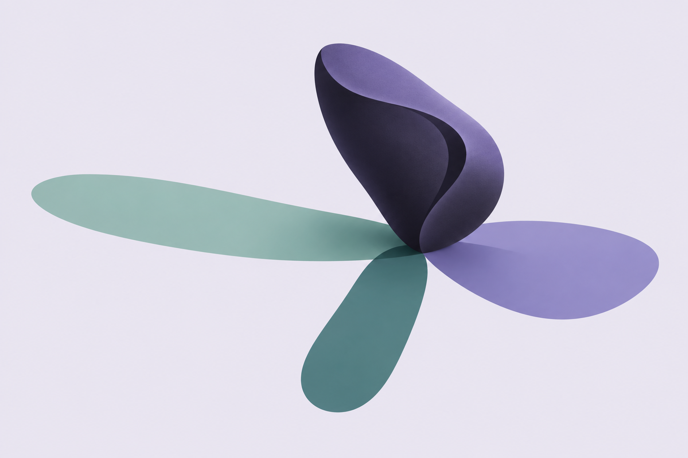
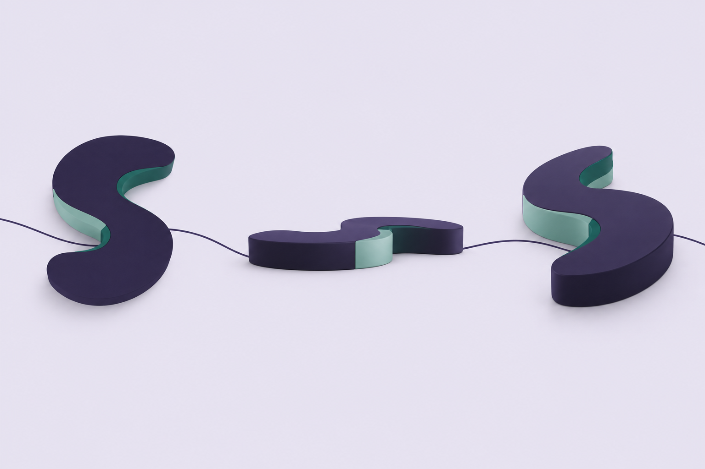
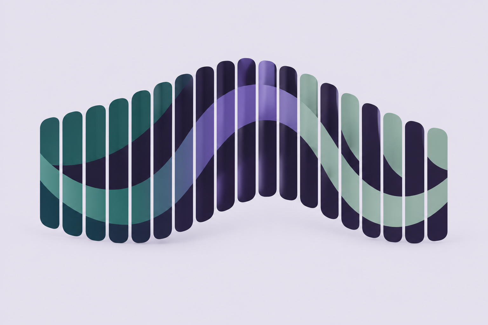
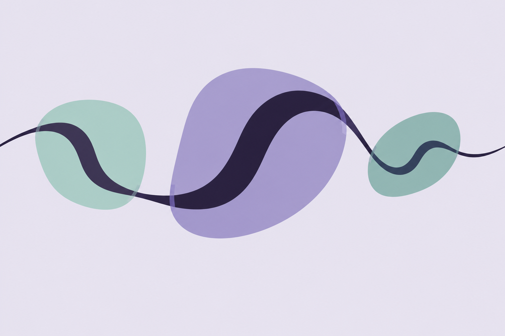
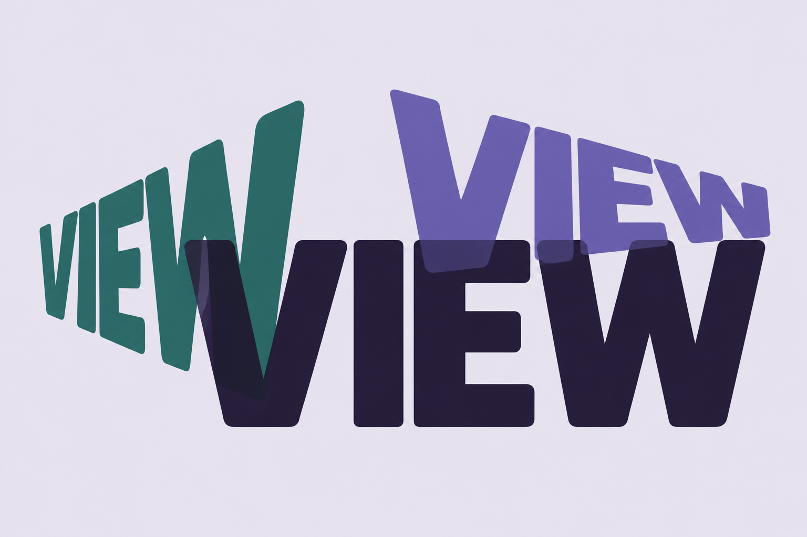

# Five perspective graphic options

Generated 2026-10-16 with the built-in image generation tool. These are review options, not website replacements. All original generated files remain preserved. Website application code has not changed for this exploration.

## 1. One form, three shadows

### Exact generation prompt

Use case: stylized-concept. Asset type: one standalone editorial graphic option for a senior marketing leader's personal website beside the headline 'Many perspectives. One throughline.' Visual brief: modern, unique, neutral and confident, with actual differing views or interpretations of a shared subject clearly visible. Flat-to-subtly-dimensional polished graphic illustration, not photography. Smooth softly curved geometry, crisp restrained contours, generous negative space. Wide 3:2 composition. Totally seamless flat mist #e8e4f0 background at all four edges, palette limited to aubergine #221b38, deep teal #246b65, eucalyptus #80afa5 and iris #6659ac. Use aubergine with confidence, accents restrained rather than washed-out pastel. No dots, stippling, rings, concentric circles, orbits, closed ribbon loops, faces, people, hair, flowers, literal scenery, trees, sharp facets, pointed shards, cubes, open books, glass gemstones, stock business symbols, watermark or enclosing picture frame. Avoid photorealistic materials and soft fabric/ribbons. The result should read as a designed brand graphic, not an atmospheric wallpaper. CONCEPT: one object can give three different impressions depending on the viewing angle. A single large matte softly rounded asymmetric sculptural solid sits just above a minimal ground, a distinctive solid curved wedge with a shallow S-shaped groove across it, no holes. It casts THREE visibly different broad, flat graphic projections in different directions: one long horizontal eucalyptus silhouette, one short wide iris silhouette, and one narrow deep-teal silhouette. All projections visibly begin at the same object so the one-to-many relationship is unmistakable. The projections overlap elegantly, like transparent ink shapes, and have soft rounded edges. Use a carefully balanced asymmetric editorial composition, subtly isometric main object, vector-like shadows with no realistic complex lighting. No text or labels. Do not make three identical shadows or three separate objects.

## 2. Three views of one form

### Exact generation prompt

Use case: stylized-concept. Asset type: one standalone editorial graphic option for a senior marketing leader's personal website beside the headline 'Many perspectives. One throughline.' Visual brief: modern, unique, neutral and confident, with actual differing views or interpretations of a shared subject clearly visible. Flat-to-subtly-dimensional polished graphic illustration, not photography. Smooth softly curved geometry, crisp restrained contours, generous negative space. Wide 3:2 composition. Totally seamless flat mist #e8e4f0 background at all four edges, palette limited to aubergine #221b38, deep teal #246b65, eucalyptus #80afa5 and iris #6659ac. Use aubergine with confidence, accents restrained rather than washed-out pastel. No dots, stippling, rings, concentric circles, orbits, closed ribbon loops, faces, people, hair, flowers, literal scenery, trees, sharp facets, pointed shards, cubes, open books, glass gemstones, stock business symbols, watermark or enclosing picture frame. Avoid photorealistic materials and soft fabric/ribbons. The result should read as a designed brand graphic, not an atmospheric wallpaper. CONCEPT: one recognizable open sculptural S-shaped SOLID shown from THREE unmistakably different camera angles. Use an architectural but softly rounded thick S-shaped slab with an unbroken solid surface, like a custom sculpted glyph rather than a ribbon; no hole and absolutely no closed loop. Show the EXACT SAME form from straight above at left, from a low side angle in the middle, and from a three-quarter elevated angle at right. Each has the same subtle asymmetrical notch and color accent so they are recognizably the same object. Make the top view show the S, the side view flatten it, and the oblique view reveal depth. Material is matte graphic color, not glass or stone. Different proportions from projection, not different scales alone. Fine continuous aubergine baseline gracefully connects the three. Strong balanced composition, objects occupy central 65% canvas. No text, no labels, no diagrams or arrows.

## 3. Lenticular shift

### Exact generation prompt

Use case: stylized-concept. Asset type: one standalone editorial graphic option for a senior marketing leader's personal website beside the headline 'Many perspectives. One throughline.' Visual brief: modern, unique, neutral and confident, with actual differing views or interpretations of a shared subject clearly visible. Flat-to-subtly-dimensional polished graphic illustration, not photography. Smooth softly curved geometry, crisp restrained contours, generous negative space. Wide 3:2 composition. Totally seamless flat mist #e8e4f0 background at all four edges, palette limited to aubergine #221b38, deep teal #246b65, eucalyptus #80afa5 and iris #6659ac. Use aubergine with confidence, accents restrained rather than washed-out pastel. No dots, stippling, rings, concentric circles, orbits, closed ribbon loops, faces, people, hair, flowers, literal scenery, trees, sharp facets, pointed shards, cubes, open books, glass gemstones, stock business symbols, watermark or enclosing picture frame. Avoid photorealistic materials and soft fabric/ribbons. The result should read as a designed brand graphic, not an atmospheric wallpaper. CONCEPT: a sophisticated lenticular optical artwork shows different views depending on angle. One flowing asymmetric mass made from 20 broad, upright, softly rounded PARALLEL SLATS. Alternating slats carry three different projected views of the SAME smooth S-shaped stroke: one view in deep teal, one in iris, one in muted eucalyptus. The color planes and changing alignment create a perceptible left-view, front-view and right-view across the object, all held in one coherent graphic. Keep the slats flat and solid with broad smooth ends and extremely subtle depth; do not form a closed cylinder, ring, tunnel, building, rib cage or book. One refined optical composition, small gaps between slats, sharp graphic clarity without pointed forms. No dotted textures, no lines resembling a data chart, no words.

## 4. Changing reflections

### Exact generation prompt

Use case: stylized-concept. Asset type: one standalone editorial graphic option for a senior marketing leader's personal website beside the headline 'Many perspectives. One throughline.' Visual brief: modern, unique, neutral and confident, with actual differing views or interpretations of a shared subject clearly visible. Flat-to-subtly-dimensional polished graphic illustration, not photography. Smooth softly curved geometry, crisp restrained contours, generous negative space. Wide 3:2 composition. Totally seamless flat mist #e8e4f0 background at all four edges, palette limited to aubergine #221b38, deep teal #246b65, eucalyptus #80afa5 and iris #6659ac. Use aubergine with confidence, accents restrained rather than washed-out pastel. No dots, stippling, rings, concentric circles, orbits, closed ribbon loops, faces, people, hair, flowers, literal scenery, trees, sharp facets, pointed shards, cubes, open books, glass gemstones, stock business symbols, watermark or enclosing picture frame. Avoid photorealistic materials and soft fabric/ribbons. The result should read as a designed brand graphic, not an atmospheric wallpaper. CONCEPT: one continuous S-shaped aubergine stroke passes through THREE large asymmetric softly rounded optical patches arranged in a loose horizontal composition. Each patch shows a clearly DIFFERENT INTERPRETATION of the exact same stroke: reversed at left, enlarged and cropped in the middle, compressed and shifted at right. The rest of the stroke connects all three through open space. Optical patches have organically curved profiles like stretched rounded oblongs, emphatically NOT circles or rings, no rectangular frames, and are flat translucent eucalyptus/iris ink shapes. The drawing inside each patch is bold and crisp enough to recognize the common motif and the different views. These should look like artistic refractions without literal glass, photographic shine, lens flares or scenery. Confident contemporary editorial graphic, open airy composition, generous space around the three soft forms. No text.

## 5. Type in perspective

### Exact generation prompt

Use case: stylized-concept. Asset type: one standalone editorial graphic option for a senior marketing leader's personal website beside the headline 'Many perspectives. One throughline.' Visual brief: modern, unique, neutral and confident, with actual differing views or interpretations of a shared subject clearly visible. Flat-to-subtly-dimensional polished graphic illustration, not photography. Smooth softly curved geometry, crisp restrained contours, generous negative space. Wide 3:2 composition. Totally seamless flat mist #e8e4f0 background at all four edges, palette limited to aubergine #221b38, deep teal #246b65, eucalyptus #80afa5 and iris #6659ac. Use aubergine with confidence, accents restrained rather than washed-out pastel. No dots, stippling, rings, concentric circles, orbits, closed ribbon loops, faces, people, hair, flowers, literal scenery, trees, sharp facets, pointed shards, cubes, open books, glass gemstones, stock business symbols, watermark or enclosing picture frame. Avoid photorealistic materials and soft fabric/ribbons. The result should read as a designed brand graphic, not an atmospheric wallpaper. CONCEPT: typography itself becomes a graphic about perspective. Use only the EXACT WORD 'VIEW', uppercase, in a custom bold neutral grotesk typeface with gently rounded terminals. Compose THREE different spatial projections of this same word, beautifully interleaved into one airy asymmetric artwork: large front-facing readable aubergine VIEW, a slightly smaller deep-teal VIEW strongly foreshortened toward the left, and an iris VIEW seen from a different elevated oblique angle toward the right. Retain legibility and exact spelling in all three. No additional text, slogans, labels or logos. Use flat opaque type with restrained translucent overlap at intersections, no word-art bevels, thick extrusions, metal, photorealism or drop shadows. This is an ambitious editorial typographic composition, not three words stacked as a list. The differing orientations must create the multiple-perspective effect. Avoid sharp geometric supporting shapes; the TYPE is the entire artwork.
